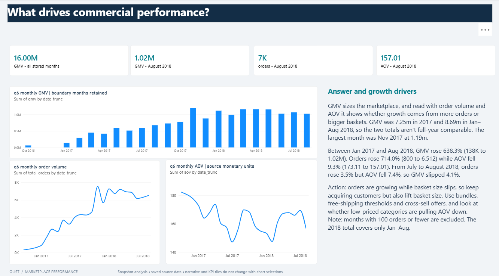
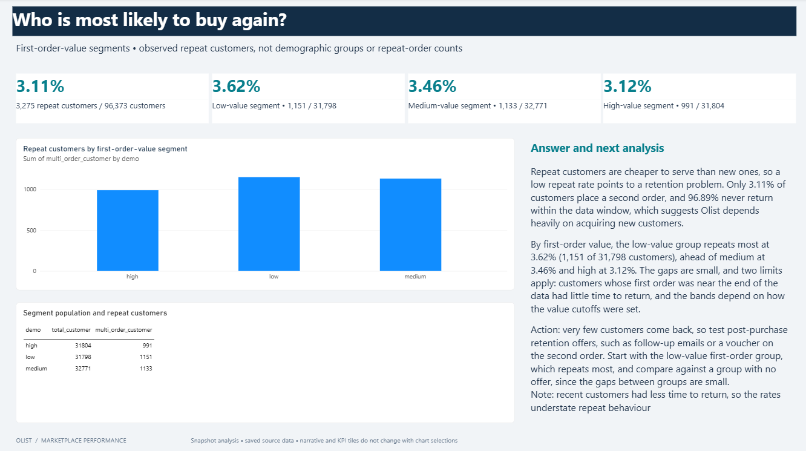

# Olist KPQ and KPI Analysis

*Using SQL to answer business questions about an e-commerce marketplace, with Python for data import and Power BI for presenting the results.*

## About this project

The goal of this analysis is to extract information that could support Olist's business decisions. I started with business questions and worked out which key performance indicators (KPIs) would help answer each one.

Most of the questions came from discussions on the Shopify community forum, where sellers talk about problems they face in running their businesses. I added a few questions of my own and adapted others from additional sources. The main focus of the project was answering these questions with SQL: deciding what to measure, writing queries in PostgreSQL and interpreting the results. I used Python to load the data into the database and Power BI to present the findings.

### Scope of the analysis

This project answers a fixed set of key performance questions (KPQs) and examines the KPIs behind them. It focuses on sales, delivery delays, cancellations, repeat purchasing and seller inactivity. The aim is to identify where the marketplace could improve revenue, reduce waiting times and give customers a reason to return.

The findings point to areas worth investigating. The dataset alone cannot explain every cause or establish whether a proposed change would work.

## Methods Used

I started by importing the CSV files into PostgreSQL using Python. In `using_sqlalchamy.ipynb`, I used `pathlib` to find the CSV files, pandas to read each file, and SQLAlchemy with the psycopg2 driver to connect to the database. Each DataFrame was written to a table named after its source file using `to_sql`, with the DataFrame index excluded. The separate `using_psycopg.ipynb` notebook contains a basic connection setup using psycopg2.

I used SQL to calculate metrics, compare monthly trends, break delivery time into stages and examine how cancellations are distributed across sellers. I also compared repeat purchasing across first-order-value segments and reviewed sellers with no recent sales.

Once the SQL results were ready, I used Power BI to present them through charts, tables and written explanations. Each section connects a business question to the relevant metric, what the result suggests and what should be investigated next.

## Technologies

**PostgreSQL / SQL:** the main analysis tool, used to answer the business questions and calculate the supporting metrics.

**Python / Jupyter Notebook:** loading the CSV data into PostgreSQL using pandas, SQLAlchemy, psycopg2 and pathlib.

**Power BI Desktop:** presenting the results through charts, tables and explanations across seven report pages.

## Dataset

The project uses the [Brazilian E-Commerce Public Dataset by Olist](https://www.kaggle.com/datasets/olistbr/brazilian-ecommerce). The analysis uses historical marketplace records, so its findings describe the period covered by the data rather than Olist's current performance.

## Report

The Power BI report brings the SQL findings together for easier review. Open `report_improved(1).pbix` in Power BI Desktop to view it.

| Page | Focus |
| --- | --- |
| Overview | Main findings and areas to investigate |
| Delivery trend | Monthly order cycle time and time spent at each stage |
| Severe delays | Stage durations for the baseline and the stored slowest-order group |
| Cancellations | Cancellation concentration, seller rates and order volumes |
| GMV and AOV | Sales value, order volume and average order value |
| Repeat customers | Repeat purchasing across first-order-value segments |
| Seller inactivity | Sellers with no recent sales and possible reactivation opportunities |

The report contains saved query results. Written explanations and many headline figures are static and do not change with chart selections. Refreshing the data requires access to the underlying sources and the appropriate connection settings.

## Questions

### 1. Which sellers have made no sale in the last 90 days?

This identifies sellers who may need attention and provides a starting point for investigating inactivity. It can help prioritize seller outreach, but the result depends on a clearly defined cutoff date and eligible seller base. The current analysis is at seller level; it does not measure unsold inventory or inactive products.

### 2. Is order cycle time improving, and where is time being spent?

Order cycle time measures the customer's wait from purchase to delivery. Breaking it into approval, seller handover and delivery stages helps locate delays. The monthly trend shows whether performance is improving consistently or whether particular periods need investigation.

### 3. Where do the slowest orders lose the most time?

Averages can hide long waits. Comparing stage times for the slowest orders with the overall baseline helps identify where severe delays build up. The current report compares a stored slowest-5% aggregate with the baseline; the average within that group should be distinguished from the 95th-percentile cutoff itself.

### 4. Are cancellations concentrated among particular sellers?

Cancellation rates show how often orders fail to go through. Looking at rates alongside cancellation counts and order volume helps identify sellers worth reviewing. A high rate based on very few orders needs more context before drawing conclusions about reliability.

### 5. How is GMV changing over time?

Gross merchandise value (GMV) tracks the value of transactions included in the analysis. Monthly comparisons show changes in marketplace activity and provide context for the other metrics. Incomplete years and boundary months need care when comparing periods.

### 6. Does sales growth come from more orders or larger baskets?

Reading average order value (AOV), GMV and order volume together helps explain changes in sales. This can guide further investigation into customer acquisition, product mix and basket size. Across multiple months, AOV should be calculated from total value divided by total orders, rather than by summing monthly averages.

### 7. How many customers return, and does repeat purchasing differ by first-order value?

The report compares observed repeat customers across low-, medium- and high-first-order-value segments. These differences can guide further retention analysis, but customers need comparable time to return. Purchase frequency and time between purchases would add useful detail beyond the repeat-customer counts shown here.

### 8. Do customers acquired in different periods behave differently?

Cohort analysis is a planned extension. Grouping customers by their first-purchase month and comparing repeat purchasing over equal periods would help show whether customer behaviour is changing. It would also reduce the bias from comparing recent customers with customers who have had much longer to return.

## Limitations and Next Steps

Some saved outputs need reconciliation before they can support firm conclusions. The repeat-customer totals and displayed percentages are inconsistent, and the report contains cancellation figures calculated at different levels: overall orders and seller-order records. These need documented definitions and consistent denominators.

The next steps are to reconcile the SQL outputs, document metric definitions, date cutoffs and segment thresholds, and add cohort analysis with equal observation windows. These would provide a stronger basis for assessing repeat purchasing. The report can then be updated to reflect the validated results.

## Contact

[Linkedin](https://www.linkedin.com/in/arjun-jat-981216252/), jatarjun123@gmail.com